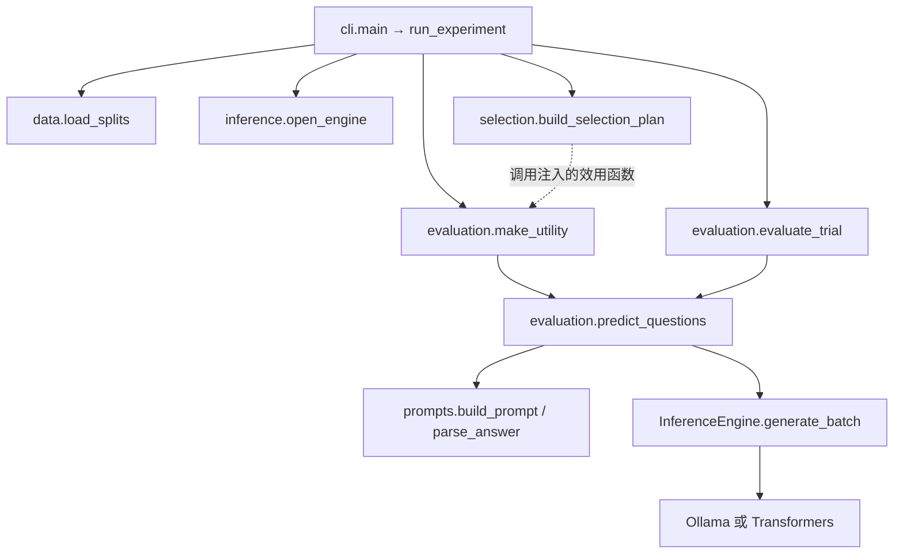

# CoopES 详细设计说明

本设计细化已有复现方案，覆盖 OpenBookQA 与 ARC-Challenge、Ollama 与 Transformers 推理，以及 Zero-shot、CoopES Uniform 和 CoopES Weighted。SHAP 用于核对标准 Shapley 值。[CoopES 复现方案](../reproduction-plan.md)

## 1. 模块边界和调用关系

| 文件 | 职责 | 直接依赖的项目模块 |
| --- | --- | --- |
| `__init__.py` | 声明 Python 包，保留模块说明 | 无 |
| `cli.py` | 读取配置、编排实验、管理运行记录 | `data`、`inference`、`selection`、`evaluation` |
| `data.py` | 加载数据、统一题目结构、生成数据划分 | 无 |
| `prompts.py` | 生成聊天消息、规范化答案标签 | `data` |
| `inference.py` | 加载推理后端、执行生成、缓存原始输出 | `prompts` |
| `selection.py` | 在给定效用函数下估计贡献并选例 | 无 |
| `evaluation.py` | 组织逐题预测、校准效用计算与测试评分 | `data`、`prompts`、`inference` |



- `cli` 持有三个数据集合。它只用候选池和校准集构造效用函数，再把该函数和候选 ID 交给 `selection`。测试集标签仅进入最终评分路径。
- `selection` 以回调调用 `V(S)`，可用人工效用替换真实模型进行核对。`evaluation` 通过结构兼容的函数类型提供回调，两个模块无需互相导入。
- `prompts` 处理任务消息。`inference` 处理模型专属聊天模板和生成参数。校准与测试共用逐题预测逻辑和缓存协议。
- `__init__.py` 仅包含包说明。命令行入口指向 `coopes.cli:main`，导入包时无需加载数据集、模型或 SHAP。

### 统一约定

- 所有签名以 Python 3.11 为基线。形参数量包含有默认值和仅限关键字的参数，实例方法的隐式 `self` 单独说明。
- 数据、配置和跨模块结果优先采用冻结 `dataclass`。由一个模块拥有的可变对象包括随机数生成器、SQLite 连接、运行计数器和在执行期间构建的字典。
- 空输入和异常按函数契约处理。配置或数据错误使用 `ValueError`，正常生成但无法解析答案使用 `None`，推理运行失败使用 `InferenceError`。团队可以直接依赖这些返回和异常类型，错误消息附上路径、方法或题目 ID 供定位。
- 准确率、Weighted-F1 和平均边际贡献使用小数。报告展示百分比时由导出层统一换算。`None` 表示分数缺失或解析失败，`0.0` 是有效计算结果。

## 2. cli.py

### 实体和变量

- `RunConfig` 包含 `data: DataConfig`、`inference: InferenceConfig`、`selection: SelectionConfig`。TOML 对应 `[data]`、`[inference]`、`[selection]` 三个配置段，推理段内含 `backend` 和 `decode`。
- `TrialReport` 包含 `trial: SelectionTrial`、`result: EvaluationResult`、`elapsed_seconds: float`。同一方法的随机试验共享方法名，以 `trial.trial_index` 标识。
- `RunSummary` 包含 `method_metrics: dict[Method, MethodSummary]`、`inference_metadata: InferenceMetadata`、`inference_stats: InferenceStats`、`elapsed_seconds: float`。`MethodSummary` 保存 `trial_count: int`、`mean_accuracy: float`、`mean_weighted_f1: float`、`mean_parse_failure_rate: float`。
- `run_dir: Path` 为当前运行目录。`config_path: Path` 指向 TOML，`trial_reports: list[TrialReport]` 保留各试验结果，`candidates_by_id: dict[str, LabeledQuestion]` 用于解析选出的 ID。`started_at: float` 取单调时钟，计算耗时。

### 核心函数

**`load_config`（1 个形参）**

```python
def load_config(config_path: Path) -> RunConfig: ...
```

用 `tomllib` 读取 TOML，校验配置段与字段类型，再构造对应的冻结配置对象。检查样本数量、`shot_count <= candidate_count`、正整数采样预算，以及后端字段和解码参数的组合约束。未知字段、缺失字段或非法取值抛出 `ValueError`，消息包含配置位置。返回可直接传入 `run_experiment` 的配置。

**`prepare_run`（3 个形参）**

```python
def prepare_run(
    run_dir: Path,
    config: RunConfig,
    splits: DatasetSplits,
) -> None: ...
```

创建运行目录，并将解析后的配置快照和 `splits.json` 逐文件原子写入。继续未完成的运行时，校验已存在的配置快照或数据划分，允许补齐中断时尚未写出的文件。已有 `summary.json` 表示上次运行已完成，此时抛出 `FileExistsError`。不同运行使用各自的运行目录，同一目录按单进程运行。成功返回 `None`。

**`write_selection_artifacts`（2 个形参）**

```python
def write_selection_artifacts(
    run_dir: Path,
    plan: SelectionPlan,
) -> None: ...
```

把 `plan.scores` 展平为 `candidate_scores.csv`，保留方法、候选 ID、分数和出现次数。把试验对应的选例 ID 及覆盖不足的候选写入 `selections.json`。按固定列顺序写临时文件，完成后原子替换目标文件。返回 `None`。此步骤先于测试运行，便于定位覆盖不足造成的中止。

**`write_evaluation_artifacts`（5 个形参）**

```python
def write_evaluation_artifacts(
    run_dir: Path,
    trial_reports: Sequence[TrialReport],
    inference_metadata: InferenceMetadata,
    inference_stats: InferenceStats,
    elapsed_seconds: float,
) -> RunSummary: ...
```

按方法聚合各次试验的指标。主实验每种方法执行一次，逐题结果保留 `trial_index`。依次写入 `predictions.jsonl`、`metrics.csv`，最后写 `summary.json`。各文件均用临时文件写完后原子替换。返回与总结文件同内容的 `RunSummary`。

**`run_experiment`（2 个形参）**

```python
def run_experiment(config: RunConfig, run_dir: Path) -> RunSummary: ...
```

依次调用 `load_splits`、`prepare_run`，在 `open_engine` 上下文中完成推理。记录 `engine.metadata` 到 `inference_metadata.json`，续跑时核对此记录。用 `make_utility` 绑定候选池和校准集，调用 `build_selection_plan` 冻结选集并写出选例记录。若均匀或加权评分存在候选覆盖缺失，保留选例记录并抛出 `ValueError`，测试阶段等待新的实验配置。否则按选集依次调用 `evaluate_trial`，汇总推理计数器、耗时与报告并返回 `RunSummary`。资源由上下文管理器释放。

**`main`（1 个形参）**

```python
def main(argv: Sequence[str] | None = None) -> int: ...
```

解析 `--config` 与 `--run-dir`。`argv=None` 时由 `argparse` 读取命令行，不合法的命令参数由 `argparse` 处理。捕获 `ValueError`、`OSError` 和 `InferenceError`，打印可定位的错误信息并返回 `1`。成功时输出总结文件位置并返回 `0`。

## 3. data.py

### 实体和变量

- `DatasetName = Literal["openbookqa", "arc_challenge"]`。`DATASET_SPECS: Mapping[DatasetName, tuple[str, str]]` 映射到 Hugging Face 数据集名与配置名，分别是 `allenai/openbookqa` / `additional` 和 `allenai/ai2_arc` / `ARC-Challenge`。
- `DataConfig` 包含 `dataset: DatasetName`、`revision: str`、`candidate_count: int`、`calibration_count: int`、`test_count: int`、`split_seed: int`。`revision` 固定到数据集仓库提交。
- `Choice` 包含 `label: str`、`text: str`。保留原有标签和选项次序，标签可以是字母或数字。
- `Question` 包含 `question_id: str`、`stem: str`、`choices: tuple[Choice, ...]`、`fact: str | None`。题目 ID 带数据集前缀。
- `LabeledQuestion` 包含 `question: Question`、`answer_label: str`。带标签实体用于训练候选和评分，待答题进入提示构造时只传 `Question`。
- `DatasetSplits` 包含 `candidates: tuple[LabeledQuestion, ...]`、`calibration: tuple[LabeledQuestion, ...]`、`test: tuple[LabeledQuestion, ...]`。
- 局部变量 `official_split: str` 指 `train`、`validation` 或 `test`。`rows_by_id: dict[str, LabeledQuestion]` 用于检测重复 ID，`rng: random.Random` 以划分种子和官方分区名初始化。

### 核心函数

**`normalize_question`（2 个形参）**

```python
def normalize_question(
    row: Mapping[str, object],
    dataset: DatasetName,
) -> LabeledQuestion: ...
```

按数据集读取 `question_stem` 或 `question`，并用对应的标签数组与文本数组构造选项。OpenBookQA 从 `fact1` 读取非空事实文本，ARC 的 `fact` 填 `None`。校验 ID、题干和选项非空、标签唯一、数组等长且 `answerKey` 对应合法选项。返回 `LabeledQuestion`。坏行抛出含数据集与题目 ID 的 `ValueError`。

**`sample_questions`（3 个形参）**

```python
def sample_questions(
    questions: Sequence[LabeledQuestion],
    count: int,
    rng: random.Random,
) -> tuple[LabeledQuestion, ...]: ...
```

按 `question_id` 排序，为抽样提供稳定输入。检查请求数量位于 `1..len(questions)`，使用传入的 RNG 无放回抽取，结果按 ID 排序后返回。请求全量时直接返回有序元组。函数不读取磁盘或全局随机状态。

**`load_splits`（1 个形参）**

```python
def load_splits(config: DataConfig) -> DatasetSplits: ...
```

使用 `datasets.load_dataset` 加载固定版本，依次标准化三个官方分区。检查各分区内的题目 ID 唯一，并使用各自确定性的 RNG 调用 `sample_questions`。检查选出的候选、校准和测试 ID 两两互斥，返回 `DatasetSplits`。主实验中 OpenBookQA 使用完整 500 条测试题，ARC-Challenge 从官方测试集抽 500 条。

## 4. prompts.py

### 实体和变量

- `ChatMessage` 包含 `role: Literal["system", "user", "assistant"]`、`content: str`。
- `PromptRequest` 包含 `question_id: str`、`example_ids: tuple[str, ...]`、`messages: tuple[ChatMessage, ...]`、`template_version: str`。所有字段均可序列化，且同一数据和模板下顺序确定。
- `SYSTEM_PROMPT: str` 是共用的英文系统指令。`OPENBOOKQA_USER_TEMPLATE: str` 和 `ARC_USER_TEMPLATE: str` 定义两种题目正文格式。`PROMPT_TEMPLATE_VERSION: str` 初始值为 `"coopes-mcq-v1"`，模板或消息组装规则调整时更新。
- `option_lines: str` 由每道题的选项按原始顺序拼接得到。`labels_by_fold: dict[str, str]` 是答案解析时使用的局部映射，只保留无歧义的大小写匹配关系。

### 系统提示词

两个数据集、两个推理后端和所有选例方法使用同一个 `SYSTEM_PROMPT`。它约定如何使用题目所附事实和如何输出答案。每次推理的第一条消息使用 `system` 角色，正文如下。

```text
You answer multiple-choice science questions.
Use the provided fact when one is present.
Choose exactly one option for the current question.
Return only its label exactly as shown in the options, without any explanation.
```

标签来自当前题目的选项，因此同一系统指令适用于 `A`、`B` 等字母标签和 `1`、`2` 等数字标签。`parse_answer` 仍按既有约定容忍 `(A)` 或 `Answer: A` 等单标签格式。

### 用户提示词模板

OpenBookQA 用 `OPENBOOKQA_USER_TEMPLATE`。`{fact}` 来自 `fact1`，先展示事实，再展示题干和选项。

```text
Fact: {fact}

Question: {stem}
Options:
{option_lines}
```

ARC-Challenge 用 `ARC_USER_TEMPLATE`。正文从题干开始。

```text
Question: {stem}
Options:
{option_lines}
```

`{stem}` 取 `Question.stem`。`{option_lines}` 由 `"{label}. {text}"` 按原始选项次序逐行生成，以换行符连接。原始标签直接保留。示例题、校准题和测试题均使用同一数据集的用户模板。

### 消息组装示例

`build_prompt` 依次组装系统消息、每个示例的 `user` 与 `assistant` 消息对，以及当前题目的 `user` 消息。示例的助手消息只包含金标。当前题的金标留到评分阶段，消息在最后一个选项后结束。下面是 ARC-Challenge 的一组单示例消息，方括号标记角色。

```text
[system]
You answer multiple-choice science questions.
Use the provided fact when one is present.
Choose exactly one option for the current question.
Return only its label exactly as shown in the options, without any explanation.

[user]
Question: Which material is most likely to conduct electricity?
Options:
1. Copper
2. Rubber

[assistant]
1

[user]
Question: Which object is most likely to float in water?
Options:
1. Steel bolt
2. Cork
```

零样本仅含系统消息与当前题目的用户消息。Ollama 把角色与正文交给 `/api/chat`，Transformers 在分词时用 `apply_chat_template(..., add_generation_prompt=True)` 添加模型所需的助手生成标记。后端共享同一组任务消息。

### 核心函数

**`_render_question`（1 个形参）**

```python
def _render_question(question: Question) -> str: ...
```

按原次序生成 `option_lines`。当 `question.fact` 为 `None` 时使用 ARC 模板，否则用 OpenBookQA 模板填入事实。依据 `Question` 字段返回用户消息正文。

**`build_prompt`（2 个形参）**

```python
def build_prompt(
    question: Question,
    examples: Sequence[LabeledQuestion],
) -> PromptRequest: ...
```

将示例按候选 ID 固定排序。用 `SYSTEM_PROMPT` 构造首条消息，调用 `_render_question` 为示例题和待答题生成用户消息。每条示例的助手消息写入 `answer_label`，待答题作为最后一条用户消息。返回由题目 ID、有序示例 ID、消息和模板版本构成的 `PromptRequest`，交给两个推理后端复用。

**`parse_answer`（2 个形参）**

```python
def parse_answer(
    text: str,
    valid_labels: Sequence[str],
) -> str | None: ...
```

去掉首尾空白，优先匹配完整合法标签。当大小写折叠后仅对应一个原始标签时，允许忽略大小写。可接受明确定义的单行标签形式，如 `(A)` 或 `Answer: A`，并按同样规则检查标签。输出原始标签。空值、多标签、自由解释或越界标签返回 `None`，并交给评分层计错。

## 5. inference.py

### 实体和变量

- `DecodeConfig` 包含 `seed: int`、`max_new_tokens: int`、`context_window: int`。
- `OllamaConfig` 包含 `base_url: str`、`model_tag: str`、`model_digest: str`、`timeout_seconds: float`、`max_attempts: int`、`decode: DecodeConfig`。`max_attempts` 包括首次请求。
- `TransformersConfig` 包含 `model_id: str`、`revision: str`、`device: str`、`dtype: Literal["float32", "float16", "bfloat16"]`、`batch_size: int`、`decode: DecodeConfig`。首版从同一固定提交加载模型和分词器。
- `InferenceConfig = OllamaConfig | TransformersConfig`。`InferenceMetadata` 保存 `backend: Literal["ollama", "transformers"]`、`model_id: str`、`model_version: str`、`template_digest: str`、`runtime_versions: Mapping[str, str]` 和 `settings: Mapping[str, str | int | float]`。后端相关的设备、精度、量化方式及分词器版本计入 `settings`，按后端能力记录。
- `GenerationResult` 包含 `text: str`、`cache_hit: bool`。返回顺序与输入请求对应，题目关联由调用方维持。
- `InferenceStats` 包含 `cache_hits: int`、`backend_calls: int`、`submitted_inputs: int`、`retry_attempts: int`。`backend_calls` 和 `submitted_inputs` 含重试，每个 Transformers 批次算一次调用。指标统计当前进程的运行量，续跑时命中旧缓存计为当前缓存命中。
- `InferenceError(RuntimeError)` 表示生成或缓存运行失败。内部 `TransientInferenceError(InferenceError)` 表示配置允许重试的 Ollama 网络错误、超时或临时服务错误。
- `InferenceEngine` 持有 `metadata: InferenceMetadata`、`_connection: sqlite3.Connection`、`_batch_limit: int`、`_max_attempts: int`、`_cache_namespace: str` 和内部计数器。`_generate_uncached: Callable[[Sequence[PromptRequest]], tuple[str, ...]]` 绑定已初始化的后端，接收一个待实际提交的批次。
- `cache_key: str` 是稳定序列化内容的 SHA-256。SQLite 表以 `cache_key` 为主键，`response_text: str` 为原始模型输出。`missing_by_key: dict[str, PromptRequest]` 保留按首次出现顺序去重的缺失请求。

### 核心函数

**`open_engine`（2 个形参）**

```python
def open_engine(
    config: InferenceConfig,
    cache_path: Path,
) -> Iterator[InferenceEngine]: ...
```

以 `@contextmanager` 暴露推理资源的生命周期。打开 SQLite 并保证缓存表存在，根据配置初始化 HTTP 客户端或加载本地模型。Ollama 核对实际模型摘要，固定批大小为 1。Transformers 用 `AutoTokenizer` 与 `AutoModelForCausalLM` 加载固定提交，设定设备和精度，模型进入评估模式。把具体后端绑定为 `_generate_uncached`，向 `with` 语句交付 `InferenceEngine`。上下文退出后关闭连接和 HTTP 客户端，并释放本地模型的持有引用。

**`_build_cache_key`（2 个形参）**

```python
def _build_cache_key(
    namespace: str,
    request: PromptRequest,
) -> str: ...
```

规范序列化命名空间和请求，计算并返回 SHA-256 十六进制字符串。命名空间由后端、模型版本、模板指纹及影响生成的配置派生。请求包含题目 ID、有序示例 ID、任务模板版本和完整消息。内容变更后按新键生成。

**`_generate_ollama`（3 个形参）**

```python
def _generate_ollama(
    requests: Sequence[PromptRequest],
    client: httpx.Client,
    config: OllamaConfig,
) -> tuple[str, ...]: ...
```

接收一条消息请求。构造 `POST /api/chat` 的请求体，关闭流式输出，固定 `temperature=0`、`seed`、`num_predict` 与 `num_ctx`。校验响应并提取 `message.content`，返回单元素文本元组。瞬时失败抛出 `TransientInferenceError`，模型配置错误或无效响应抛出 `InferenceError`。

**`_generate_transformers`（4 个形参）**

```python
def _generate_transformers(
    requests: Sequence[PromptRequest],
    model: PreTrainedModel,
    tokenizer: PreTrainedTokenizerBase,
    config: TransformersConfig,
) -> tuple[str, ...]: ...
```

应用模型的聊天模板，按批左填充并传入 attention mask。分词器缺少填充 token 时使用其结束 token，两者都缺少时抛出 `InferenceError`。验证输入长度加生成上限不超过可用上下文。使用 `torch.inference_mode()`，以 `do_sample=False`、`num_beams=1` 和固定 `max_new_tokens` 调用 `model.generate()`。按批的填充后输入宽度切除提示前缀，解码新增 token，返回与请求同序的文本元组。显存不足或上下文超限时抛出可定位的 `InferenceError`。

**`InferenceEngine._generate_missing_batch`（1 个显式形参，另有 `self`）**

```python
def _generate_missing_batch(
    self,
    requests: Sequence[PromptRequest],
) -> tuple[str, ...]: ...
```

执行一个未命中的批次，每次提交更新调用数和逐题输入数，校验响应数量。仅对 `TransientInferenceError` 按 `_max_attempts` 做有限退避重试，并更新重试计数。返回整个批次的原始文本，耗尽重试时抛出 `InferenceError`。

**`InferenceEngine.generate_batch`（1 个显式形参，另有 `self`）**

```python
def generate_batch(
    self,
    requests: Sequence[PromptRequest],
) -> tuple[GenerationResult, ...]: ...
```

为请求计算键并读取缓存。对未命中的键去重，按后端批大小切分，逐批调用 `_generate_missing_batch`。每个成功批次在同一 SQLite 事务写入原始文本，后续批次失败时可以复用此前提交的数据。按原请求顺序回填 `GenerationResult`，`cache_hit` 表示该键在本次调用生成前已存在。空序列返回空元组，不调用后端。

**`InferenceEngine.snapshot_stats`（0 个显式形参，另有 `self`）**

```python
def snapshot_stats(self) -> InferenceStats: ...
```

读取内部计数器并返回冻结的统计快照，供 `run_experiment` 持久化。

## 6. selection.py

### 实体和变量

- `Method = Literal["zero_shot", "coopes_uniform", "coopes_weighted"]`。`ShapMethod = Literal["exact", "permutation"]`。
- `UtilityFunction = Callable[[tuple[str, ...]], float]`。输入是去重且按 ID 排序的候选元组，空元组表示零样本，输出是同一校准集上的准确率。
- `SelectionConfig` 包含 `shot_count: int`、`num_samples: int`、`sample_seed: int`、`epsilon: float`。`shot_count` 对应论文的 $k$，`num_samples` 对应 $M$。主实验使用 `shot_count=4`、`num_samples=200`、`epsilon=0.05`。
- `CandidateScore` 包含 `candidate_id: str`、`score: float | None`、`sample_count: int`。`sample_count` 是该候选进入前缀的次数。
- `SelectionTrial` 包含 `method: Method`、`trial_index: int`、`candidate_ids: tuple[str, ...]`。试验序号从 1 开始。`SelectionPlan` 包含 `trials: tuple[SelectionTrial, ...]`、`scores: dict[Method, tuple[CandidateScore, ...]]`、`missing_by_method: dict[Method, tuple[str, ...]]`。只有发生缺失的方法进入 `missing_by_method`。
- 采样变量 `rng: np.random.Generator`、`remaining: list[str]` 和 `probabilities: NDArray[np.float64]`。贡献累加使用 `gain_by_id: dict[str, float]` 和 `count_by_id: dict[str, int]`。`previous_value: float` 与 `next_value: float` 分别记录加入前、加入后的效用。
- `weights: dict[str, float]` 保存 $\epsilon+V(\{e\})$，用于加权采样。`SHAP_EXACT_MAX_CANDIDATES = 12` 为设计中的精确计算上限，小规模核对用 6 个候选。

### 核心函数

**`draw_prefix`（4 个形参）**

```python
def draw_prefix(
    candidate_ids: Sequence[str],
    shot_count: int,
    rng: np.random.Generator,
    weights: Mapping[str, float] | None = None,
) -> tuple[str, ...]: ...
```

从候选副本抽取 `shot_count` 个不同 ID，返回抽取顺序。每步在剩余候选中等概率抽取，或者把对应权重重新归一化后抽取，再移除已抽中的候选。调用方在批量采样开始前保证候选 ID 唯一、长度足够、权重覆盖完全且有限为正。该函数只读取传入的 RNG 和参数。

**`estimate_marginal_contributions`（4 个形参）**

```python
def estimate_marginal_contributions(
    candidate_ids: Sequence[str],
    utility: UtilityFunction,
    config: SelectionConfig,
    *,
    weights: Mapping[str, float] | None = None,
) -> tuple[CandidateScore, ...]: ...
```

校验候选、采样参数及权重后，按 ID 排序建立抽样输入，以 `sample_seed` 初始化 RNG，计算一次空集效用。重复 `num_samples` 次调用 `draw_prefix`。每轮从空集开始，按抽取顺序加入候选，但传入 `utility` 的集合键始终按 ID 排序。将 `next_value - previous_value` 累加到当前候选并增加其次数。输出覆盖全部候选的 `CandidateScore` 元组，按候选 ID 排序。有观测时为贡献总和除以实际次数，零观测记录 `score=None`、`sample_count=0`。

**`rank_candidates`（2 个形参）**

```python
def rank_candidates(
    scores: Sequence[CandidateScore],
    shot_count: int,
) -> tuple[str, ...]: ...
```

检查分数均可用且数量满足 `shot_count`。按分数降序、同分按候选 ID 升序，返回前 $k$ 个候选 ID。返回顺序是排名顺序，提示渲染统一使用 ID 顺序。覆盖不足时抛出 `ValueError`。

**`build_selection_plan`（3 个形参）**

```python
def build_selection_plan(
    candidate_ids: Sequence[str],
    utility: UtilityFunction,
    config: SelectionConfig,
) -> SelectionPlan: ...
```

先创建空选集用于 Zero-shot。计算每个候选的单示例效用，再由 $w_e=\epsilon+V(\{e\})$ 得到加权采样权重。分别调用 `estimate_marginal_contributions` 产生均匀和加权结果，两次估计分别从相同 `sample_seed` 初始化。两种 CoopES 均用 `rank_candidates` 生成选集。若某一方法有零观测候选，记录缺失 ID 并省略该方法的选集。返回候选评分、已生成的试验和覆盖信息，交给 CLI 决定能否进入测试。

**`compute_shapley`（5 个形参）**

```python
def compute_shapley(
    candidate_ids: Sequence[str],
    utility: UtilityFunction,
    *,
    method: ShapMethod = "exact",
    max_evals: int | None = None,
    seed: int = 42,
) -> dict[str, float]: ...
```

先校验候选非空且唯一，再按 ID 排序，为每个候选分配一个二值特征位置。将一行 `int8` 全零背景传给 `shap.maskers.Independent`，解释同类型的全一输入。精确模式用 `shap.ExactExplainer`，检查候选数及完整枚举所需预算。排列近似模式用 `shap.PermutationExplainer`，要求显式预算至少为 `2 * candidate_count + 1`，并传入 `seed`。输出候选 ID 到标准 Shapley 值的映射。此入口用于小规模计算核对或独立对照，常规 CoopES 运行调用前缀估计函数。[SHAP ExactExplainer](https://shap.readthedocs.io/en/latest/generated/shap.ExactExplainer.html) · [SHAP PermutationExplainer](https://shap.readthedocs.io/en/latest/generated/shap.PermutationExplainer.html)

`compute_shapley` 内部的 SHAP 适配器签名为 `evaluate_masks(masks: NDArray[np.int8]) -> NDArray[np.float64]`（1 个形参）。它接收形状为 `(batch_size, candidate_count)` 的掩码，逐行将值为 1 的位置映射为候选 ID，调用 `utility` 后返回与行顺序对应的一维效用数组。

## 7. evaluation.py

### 实体和变量

- `Prediction` 包含 `question_id: str`、`raw_text: str`、`predicted_label: str | None`、`cache_hit: bool`。该实体由生成文本与合法选项解析得到。
- `GradedPrediction` 包含 `prediction: Prediction`、`gold_label: str`、`is_correct: bool`。金标仅在评分时加入。
- `EvaluationMetrics` 包含 `question_count: int`、`accuracy: float`、`weighted_f1: float`、`parse_failure_rate: float`。
- `EvaluationResult` 包含 `rows: tuple[GradedPrediction, ...]`、`metrics: EvaluationMetrics`。每次随机试验各自产生一个结果，后续由 CLI 汇总。
- `INVALID_PREDICTION_LABEL = ""` 是计算 F1 时的内部占位值，数据层保证合法标签非空。原始结果中无法解析的标签序列化为 `null`。
- `utility_cache: dict[tuple[str, ...], float]` 保存单次运行内的组合效用。该缓存与 SQLite 的逐题生成缓存分别服务于选例计算和断点重跑。

### 核心函数

**`predict_questions`（3 个形参）**

```python
def predict_questions(
    questions: Sequence[Question],
    examples: Sequence[LabeledQuestion],
    engine: InferenceEngine,
) -> tuple[Prediction, ...]: ...
```

针对每道待答题调用 `build_prompt`，使用 `engine.generate_batch` 获取与题目同序的原始文本。针对每道题的合法选项调用 `parse_answer`，生成逐题 `Prediction`。返回有序元组，空输入返回空元组。

**`grade_predictions`（2 个形参）**

```python
def grade_predictions(
    questions: Sequence[LabeledQuestion],
    predictions: Sequence[Prediction],
) -> tuple[GradedPrediction, ...]: ...
```

检查题目与预测的 ID 唯一且一一对应，按题目顺序结合金标。预测标签与金标相同则 `is_correct=True`，解析失败时为 `False`。返回逐题评分结果，ID 不匹配时抛出 `ValueError`。

**`make_utility`（3 个形参）**

```python
def make_utility(
    candidates: Sequence[LabeledQuestion],
    calibration: Sequence[LabeledQuestion],
    engine: InferenceEngine,
) -> Callable[[tuple[str, ...]], float]: ...
```

校验校准集非空，建立候选 ID 到示例的映射，返回闭包 `utility(candidate_ids: tuple[str, ...]) -> float`（1 个形参）。闭包校验 ID 后按 ID 排序，使用有序元组作为缓存键。缓存未命中时取出示例，将校准题的 `Question` 传给 `predict_questions`，再调用 `grade_predictions`。用正确题数除以校准题数，把结果写入 `utility_cache` 并返回。空元组按零样本计算，未知或重复的候选 ID 抛出 `ValueError`。

**`compute_metrics`（1 个形参）**

```python
def compute_metrics(
    rows: Sequence[GradedPrediction],
) -> EvaluationMetrics: ...
```

要求 `rows` 非空。准确率为正确题占比，解析失败率为标签缺失的题数占比。将缺失预测映射为内部占位标签，调用 `sklearn.metrics.f1_score`，参数为 `average="weighted"` 和 `zero_division=0`，计算按真实标签支持度加权的 F1。占位标签的真实支持度为零，被解析失败影响的真实类别仍产生漏判。返回四项指标。

**`evaluate_trial`（3 个形参）**

```python
def evaluate_trial(
    examples: Sequence[LabeledQuestion],
    test_questions: Sequence[LabeledQuestion],
    engine: InferenceEngine,
) -> EvaluationResult: ...
```

接收已冻结的示例集和非空测试集。将测试题的无标签内容交给 `predict_questions`，再依次调用 `grade_predictions` 和 `compute_metrics`，返回逐题结果与指标。权重、候选排名及采样参数由选例阶段生成。

## 8. 关键调用链和产物

| 阶段 | 调用顺序 | 输出或状态 |
| --- | --- | --- |
| 配置与划分 | `main → load_config / run_experiment`。`run_experiment → load_splits → normalize_question / sample_questions`。 | 解析后的配置、三组题目及 `splits.json` |
| 校准 | `run_experiment → make_utility / build_selection_plan`。`build_selection_plan → utility → predict_questions / grade_predictions`。 | 空集效用和加权采样权重 |
| CoopES 估计 | `build_selection_plan → estimate_marginal_contributions / rank_candidates`。`estimate_marginal_contributions → draw_prefix / utility`。 | 每个候选的分数与出现次数、冻结选集 |
| SHAP 核对 | `compute_shapley → SHAP 解释器 → 二值掩码适配器 → utility` | 按 ID 索引的标准 Shapley 值 |
| 逐题预测 | `predict_questions → build_prompt / InferenceEngine.generate_batch / parse_answer`。`InferenceEngine.generate_batch → InferenceEngine._generate_missing_batch → 后端批次函数`。 | 按题目顺序返回的答案、逐题生成缓存 |
| 测试与评分 | `run_experiment → evaluate_trial → predict_questions / grade_predictions / compute_metrics` | 每次试验的逐题评分与指标 |
| 导出 | `run_experiment → write_selection_artifacts`（测试前），`run_experiment → write_evaluation_artifacts`（测试后） | 候选评分、选集、逐题预测、试验指标和运行总结 |

表中的斜杠表示同一调用方依次调用多个函数。Zero-shot 使用空选集，三种方法的测试指标统一在 `evaluate_trial` 中计算。

## 9. Python 代码风格和验收

- 遵循 PEP 8。使用 4 空格缩进，函数与变量使用 `snake_case`，类使用 `CapWords`，模块常量使用大写。导入按标准库、第三方库、项目模块分组。代码每行最多 79 字符，注释与文档字符串每行最多 72 字符。[PEP 8](https://peps.python.org/pep-0008/)
- 每个核心函数提供类型注解和文档字符串，明确输入约束、返回结果和调用方应处理的异常。跨模块传递已验证的配置和领域实体。字典用于按键索引、缓存或序列化等有明确用途的场合。
- 每个函数承担一个职责，函数体原则上不超过 200 个物理行，空行、注释、文档字符串和内嵌函数都计入。超过时按独立职责拆分，例如把后端生成、请求重试和持久化分开。只有能单独说明职责、具有独立测试价值或存在实际复用的逻辑才提取为函数，避免为简单表达式增加转发层。
- 依赖方向以第 1 节的表为准。先校验 TOML、数据行、模型响应、SHAP 预算和候选输入，再进入对应算法。选例仅依赖候选 ID、配置和效用回调，后端切换在 `open_engine` 完成。

| 验收项 | 判定方式 |
| --- | --- |
| 数据与提示 | 数据 ID 的三部分互斥。对同一组选例打乱顺序，生成的消息保持一致。核对两种用户模板、零样本的角色顺序和单示例消息对，确认待答题只含题干、选项和所需的事实，金标只在评分阶段读取。 |
| 采样与 SHAP | 固定种子重复执行得到同一排名。用 6 个候选枚举完整排列与 SHAP 精确值逐项对照。另用截断前缀的期望值检查截断估计，校验计数总和为 $Mk$。 |
| 覆盖不足 | 让某候选在采样中零次出现，评分文件保留其缺失记录，CLI 在开始测试前明确中止。 |
| 推理和缓存 | 用测试替身让两种后端按相同契约返回原始文本。缓存命中时后端调用数不增加。模拟后续批次失败，已提交的批次仍可复用。 |
| 评估和报告 | 用包含字母标签、数字标签及无效输出的固定样本核对指标。检查产物只展示三种方法，并用 ARC-C × Qwen2.5-7B 小规模配置检查断点续跑。 |
| 代码结构 | 审查每个核心函数的职责及行数、导入方向、类型注解和 PEP 8 格式。 |
